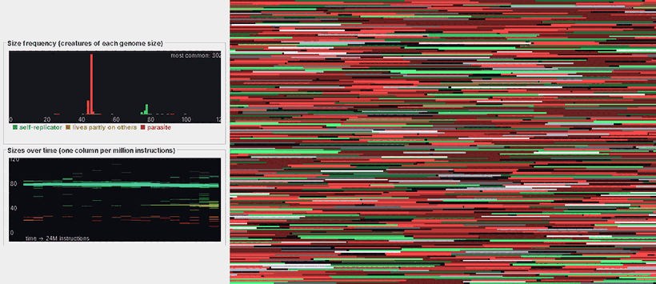
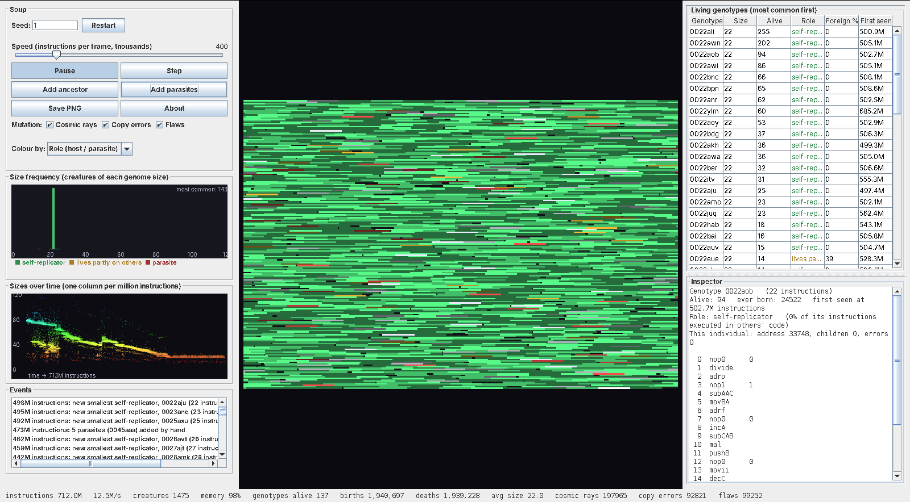

# Tierra Lab



**Watch evolution happen inside a computer's memory.** Tierra Lab recreates *Tierra*, the famous artificial-life experiment by the ecologist Thomas S. Ray. Small machine-code programs live in the memory of a virtual computer, copy themselves, compete for space and time, make mistakes and evolve. You start with one hand-written creature, and within seconds evolution invents parasites.

It's a single Java file. There's nothing to install beyond Java itself.

## Running it

You need **Java 17 or newer**. Download `TierraLab.java`, open a terminal in the same folder and type:

```
java TierraLab.java
```

The window opens and the soup starts evolving straight away.

## What you're looking at



**The soup (middle).** This is the computer's whole memory, 60,000 instructions, one pixel each, read left to right like a page. Every coloured streak is a creature:

- **Green**: copies itself unaided.
- **Red**: a parasite, mostly running other creatures' code.
- **Amber**: lives partly on others.
- **Dim**: a daughter still being copied.
- **Dark**: free memory, full of code left behind by the dead.

**Click any creature** to read its program in the Inspector, instruction by instruction.

**Living genotypes (right).** Every kind of creature alive right now, most common first. Names follow Ray's style: `0080aaa` is the 80-instruction ancestor, and `0045aaa` is a 45-instruction parasite.

**Size frequency (left).** How many creatures there are of each size. This was Ray's favourite way to watch a run.

**Sizes over time (left).** Each column is a million instructions. As evolution finds shorter ways to copy, the line steps down like a staircase.

**Events.** The milestones of the run: the first parasites, each new smallest self-replicator, and extinction if it happens.

**The status bar** shows instructions executed, creatures alive, how full memory is, births, deaths and mutation counts.

## How it works, briefly

- The ancestor is an 80-instruction program written by Ray. It finds its own beginning and end, asks for memory for a daughter (`mal`), copies itself into it one instruction at a time (`movii`), and sets the daughter free (`divide`). Then both do it again.
- Programs find their way around using **templates**, patterns of the do-nothing instructions `nop0` and `nop1`. A jump goes to the nearest matching pattern, even one inside a neighbour. Neighbours' memory can't be written to, but it *can* be run. That's how parasites borrow other creatures' copying code.
- Every creature gets a short turn on the CPU in rotation. When memory fills up, the **reaper** kills old creatures and clumsy ones that make errors.
- Copies aren't perfect. **Cosmic rays** flip bits in memory, **copy errors** corrupt instructions as they're copied, and **flaws** make instructions occasionally give a slightly wrong answer.

There's no goal and no fitness score. Creatures that copy themselves faster and more reliably simply leave more descendants.

## What to expect

- **Parasites** usually appear within the first 40–120 million instructions, which is a few seconds. They tend to boom and then crash as the hosts change.
- **Shrinking.** Over a few hundred million instructions, self-replicators get smaller: 80, then the 60s, 40s and 30s. Often they end in the low 20s. Ray's smallest self-replicator was 22 instructions long.
- **Mixed creatures**, which live partly on others, come and go.
- **Every seed tells a different story.** Some soups die out early, just as some of Ray's did. If that happens, press **Restart** with another seed, or **Add ancestor**.

## Controls

| Control | What it does |
| --- | --- |
| Seed / Restart | Wipe the soup and start again from one ancestor |
| Speed | How many instructions run between screen updates |
| Pause / Play, Step | Stop the clock, or run a single instruction |
| Add ancestor | Put one copy of the 80-instruction ancestor into the soup |
| Add parasites | Add five copies of Ray's parasite `0045aaa` |
| Mutation tick-boxes | Switch cosmic rays, copy errors or flaws on and off |
| Colour by | Colour creatures by role, or by genome size |
| Save PNG | Save a picture of the soup |
| About | A short explanation of Tierra |

## Things to try

1. **Watch the first parasites arrive.** Keep an eye on the Events list.
2. **Add parasites early**, while the ancestor is the only host, and watch the arms race.
3. **Turn off a kind of mutation** and restart. What changes? With all three off, the soup fills with copies of the ancestor and stays that way.
4. **Read a tiny creature.** Once sizes reach the 20s, click one and work out how it copies itself in so few instructions.
5. **Try different seeds.** Each one is a different history of life.

## Credits

**Tierra was created by Thomas S. Ray.** All credit for the design of the Tierra virtual computer, its instruction set, the ancestor `0080aaa` and the parasite `0045aaa` belongs to him. Tierra is Copyright © Thomas S. Ray.

- T. S. Ray, [*An Approach to the Synthesis of Life*](https://web.archive.org/web/20150711051305/http://life.ou.edu/pubs/alife2/tierra.tex), Artificial Life II, Santa Fe Institute Studies in the Sciences of Complexity, vol. XI, 1991.
- [The Tierra home page](http://life.ou.edu/tierra/)
- [Tierra (computer simulation)](https://en.wikipedia.org/wiki/Tierra_(computer_simulation)) on Wikipedia

Tierra Lab is an independent implementation of Ray's instruction set 0. It follows his published descriptions and the default settings of his Tierra 6.02 simulator: a 60,000-instruction soup, template addressing, write-protected memory, a time slicer, a reaper queue, and his three kinds of mutation.

---

Architect: Mario Gianota · Implementation: Claude (Anthropic) · MIT licence (this implementation)
